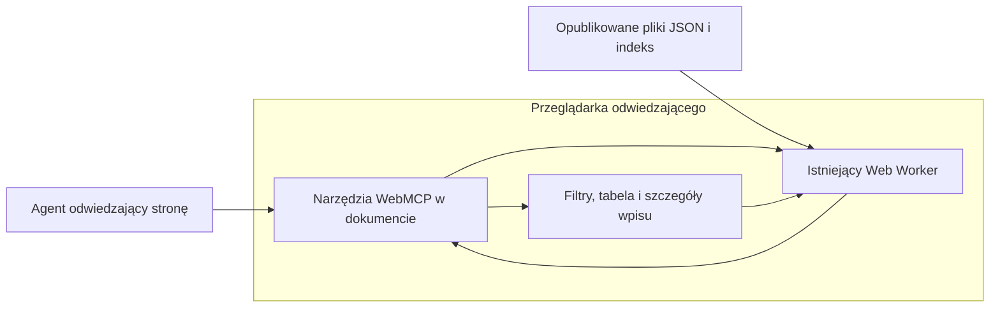

# WebMCP: nawigacja agentów po statycznym rejestrze

Stan rozpoznania: 11 września 2026 r. Zakres uzgodniony z użytkownikiem: **strona pozostaje statyczna; WebMCP pomaga agentom odwiedzającym stronę poruszać się po jej zbiorze danych**. Dokument opisuje rekomendację, a nie wdrożone już narzędzia.

## Rekomendacja

Dodać do JavaScript strony niewielką warstwę WebMCP, która udostępnia wyszukiwanie, odczyt wpisów oraz nawigację w istniejącym interfejsie. Obliczenia wykonuje obecny Web Worker w przeglądarce odwiedzającego. Publikowany pakiet nadal składa się z HTML, CSS, JavaScript i JSON, tak jak dzisiaj. [Obecna publikacja](../README.md), [worker wyszukiwarki](../src/search/worker.ts).

WebMCP pozwala stronie zarejestrować funkcje JavaScript przez `document.modelContext.registerTool()`. Obsługująca je przeglądarka lub integracja agenta może odkryć funkcje i wywołać je podczas odwiedzin. Jest to interfejs działającego dokumentu. W tym projekcie nie wymaga serwera MCP, endpointu API, bazy danych ani dodatkowego hostingu. [API WebMCP](https://developer.chrome.com/docs/ai/webmcp/imperative-api), [wyjaśnienie autorów](https://github.com/webmachinelearning/webmcp/blob/main/README.md).

Wcześniejszy raport nadmiernie rozszerzał zakres o klasyczny MCP. Projekt opisany tutaj dotyczy wyłącznie funkcji strony wykonywanych w przeglądarce.

Strzałki przedstawiają proponowane wywołania i odczyt danych. Rejestracja narzędzi odbywa się w dokumencie głównym; wyszukiwanie pozostaje w workerze. Agent otrzymuje wynik funkcji strony. [Umiejscowienie API w specyfikacji](https://webmachinelearning.github.io/webmcp/#api).

## Co projekt już zapewnia

| Element | Zastosowanie dla agenta |
| --- | --- |
| 66 343 wpisy z publikacji 2015–2026 | Jeden określony zbiór do przeglądania; rok 2026 obejmuje daty zawarcia do 29 lipca. [README](../README.md) |
| Silnik MiniSearch i filtry | Wyszukiwanie po tekście, wydziałach, datach i kwocie oraz sortowanie. [Silnik](../src/search/engine.ts), [model](../src/search/model.ts) |
| Manifest, rekordy i indeks | Przeglądarka już pobiera gotowe pliki z pakietu strony. [Generator plików](../scripts/przygotuj-strone.ts), [ładowanie danych](../src/search/worker.ts) |
| Pełne szczegóły i odnośnik do wpisu | Agent może wskazać i otworzyć konkretną pozycję przez istniejący widok. [Nawigacja strony](../site/main.ts), [prezentacja wpisu](../src/ui/record.ts) |

Wynik narzędzia powinien pochodzić z pełnego zbioru w workerze. Tabela renderuje tylko okno wyników, więc odczyt widocznych wierszy nie zapewnia dostępu do wszystkich dopasowań. [Worker i stronicowanie](../src/search/worker.ts), [okno tabeli](../src/ui/window.ts).

## Narzędzia do przeglądania danych

Poniższe nazwy, parametry i limity są propozycją interfejsu tej strony.

| Narzędzie | Zadanie | Wynik lub zmiana widoku |
| --- | --- | --- |
| `get_dataset_info` | Poznać zakres, pola i dostępne filtry | Liczba wpisów, lata, wydziały, znaczenie pól, zasady wyszukiwania, wersja i odsyłacze do JSON |
| `search_entries` | Znaleźć wpisy i przeglądać kolejne strony wyników | Krótkie rekordy, `total`, pozycja następnej strony, zastosowane kryteria i wersja zbioru |
| `get_entry` | Odczytać wskazany wpis w całości | Wszystkie pola, pełny opis, pochodzenie, ślad korekt i odnośnik do wpisu |
| `show_results` | Pokazać użytkownikowi wybrane wyszukiwanie | Ustawienie obsługiwanych filtrów i sortowania w istniejącym UI; potwierdzenie po wyświetleniu wyniku |
| `show_entry` | Otworzyć wskazany wpis użytkownikowi | Istniejące okno szczegółów i odnośnik; potwierdzenie otwarcia |

Rekomendowany przebieg: agent poznaje pola przez `get_dataset_info`, wyszukuje wpisy, pobiera pełne szczegóły wybranych pozycji, a na prośbę użytkownika pokazuje wynik lub otwiera wpis. Dzięki temu może zarówno analizować dane, jak i prowadzić użytkownika po tym samym interfejsie.

`search_entries` i `get_entry` nie muszą przestawiać widoku przy każdym odczycie. Zmiana widoku ma jawne narzędzia `show_results` i `show_entry`. Wszystkie te operacje dotyczą przeglądania; źródłowe pliki pozostają niezmienione. Dla `show_results` początkowo użyć wyłącznie kryteriów, które UI potrafi przedstawić, aby wyświetlone filtry odpowiadały wykonanemu zapytaniu. [Obecne kontrolki i obsługa wyników](../site/main.ts).

## Jak dołączyć WebMCP do istniejącego kodu

1. W module strony wykryć `typeof document.modelContext?.registerTool === "function"`.
2. Zarejestrować narzędzia po przygotowaniu danych. Każde otrzymuje nazwę, opis, `inputSchema` i asynchroniczne `execute`. Są to elementy API WebMCP. [Rejestracja narzędzi](https://developer.chrome.com/docs/ai/webmcp/imperative-api).
3. Obsługę zapytań połączyć z istniejącym workerem, używając identyfikatorów żądań i oczekiwania na właściwą odpowiedź. Obecny worker ma jeden stan `current` dla wyniku UI; zapytania agenta potrzebują osobnych odpowiedzi, aby nie nadpisywały przewijanego wyniku człowieka. Zbiór i indeks nadal wystarczy załadować raz. [Stan workera](../src/search/worker.ts), [komunikaty aplikacji](../src/search/protocol.ts).
4. Narzędzia nawigacji oprzeć na funkcjach obsługujących obecne filtry i okno wpisu. Potwierdzać wykonanie po otrzymaniu wyniku i zmianie widoku. [Obsługa strony](../site/main.ts).
5. Zwracać z `execute` zwykłe obiekty możliwe do serializacji jako JSON, np. rekordy i liczniki. Format tych obiektów ustala aplikacja; odpowiedź nie potrzebuje koperty protokołu serwerowego MCP. [Zwracanie wyników WebMCP](https://webmachinelearning.github.io/webmcp/#api).
6. Obsłużyć błędne wejście, brak wpisu, niedostępne dane, anulowanie oraz ponowną inicjalizację. Cykl rejestracji i anulowanie opisuje [API imperatywne Chrome](https://developer.chrome.com/docs/ai/webmcp/imperative-api).

To zmiany w kodzie dostarczanym jako pliki statyczne. Dotychczasowy build przygotowuje dane przed publikacją, a odwiedzający wykonuje wyszukiwanie w swojej przeglądarce. [Build i pliki wyjściowe](../scripts/przygotuj-strone.ts).

## Wyszukiwanie i stronicowanie zrozumiałe dla agenta

Na początek zachować zachowanie publicznej wyszukiwarki i opisać je w narzędziu: łączenie słów i filtrów przez AND, normalizacja wielkości liter i polskich znaków, tolerancja jednej literówki od czterech znaków w odpowiednich polach, fragmenty numerów umów, włączne granice dat oraz ścisłe porównania kwoty `>` i `<`. [Publiczne zapytanie](../src/search/public-query.ts), [rzeczywiste reguły silnika](../src/search/engine.ts).

Proponowane parametry `search_entries`: `text`, `columns`, `filters`, `sort`, `offset`, `limit` i opcjonalnie oczekiwana `datasetVersion`. Każde wywołanie zawiera pełne kryteria. Dla statycznej wersji zbioru stronicowanie przez pozycję wystarcza, jeśli kolejność jest deterministyczna. Obecny silnik rozstrzyga remisy przez rok i pozycję źródłową. [Sortowanie](../src/search/engine.ts).

Przyjąć np. domyślnie 20 i maksymalnie 100 wyników oraz limit rozmiaru odpowiedzi. Zwracać `total`, `offset`, `nextOffset` lub `null` na końcu, zastosowane kryteria i wersję. Opisy w wyszukiwaniu można skracać z oznaczeniem skrótu; `get_entry` udostępnia całość. Jest to nasze stronicowanie danych, zdefiniowane w funkcji strony.

Filtr `sourceYears` i dokładna równość pola mogą być późniejszymi uzupełnieniami. Nie należy obiecywać ich w pierwszym narzędziu bez implementacji: obecny model nie ma osobnego filtra roku źródłowego, a profil `control` wyłącza literówki, lecz zachowuje dopasowanie prefiksów. [Model](../src/search/model.ts), [silnik](../src/search/engine.ts).

## Pochodzenie i interpretacja

Do wyników dodać identyfikator wersji oparty na istniejących artefaktach. Dla pełnego wpisu zwracać `id`, `sourceYear`, `sourcePosition`, nazwę i SHA-256 pliku źródłowego, odnośniki do kopii i publikacji oraz korekty dotyczące tej pozycji. Pełne metadane i opis pól wystarczy podać w `get_dataset_info`. [Loader](../scripts/dane.ts), [manifest](../scripts/przygotuj-strone.ts).

ID `2024:183` wskazuje pozycję w danej publikacji. Powiązanie z wersją pozwala wykryć zmianę zbioru między wywołaniami. Hash w nazwie pliku nie zapewnia zachowania dawnych wydań: obecny generator czyści katalog wynikowy. Tego ograniczenia nie należy przedstawiać jako gwarancji archiwizacji. [Identyfikatory i generowanie](../scripts/dane.ts), [pliki wyjściowe](../scripts/przygotuj-strone.ts).

Opisy narzędzi powinny wyjaśniać, że wpis nie oznacza automatycznie pojedynczej płatności ani unikalnej umowy, a rok źródłowy nie oznacza roku płatności. Zachować osobne wpisy o powtarzających się numerach umów, sześć udokumentowanych korekt dat oraz informację o niepełnym 2026 r. Waluta nie została jawnie podana w metadanych źródła. [Słownik](../CONTEXT.md), [analiza danych](analiza-danych.md).

Opcjonalne `summarize_entries` można dodać później, jeśli potrzebne będą zestawienia. Ono również wykonuje obliczenia lokalnie w workerze: sumuje cały dokładnie określony zbiór dopasowań, używając arytmetyki dziesiętnej lub całkowitych setnych jednostki, i zwraca kryteria oraz liczebność. Nie jest konieczne do udostępnienia nawigacji po danych.

## Zgodność z przeglądarką i agentem

WebMCP jest nadal rozwijanym projektem specyfikacji. Aktualny draft z 10 września 2026 r. używa `document.modelContext`. Obsługa musi istnieć zarówno w przeglądarce, jak i integracji agenta; samo zarejestrowanie funkcji nie gwarantuje, że każdy odwiedzający agent ją odkryje. [Specyfikacja](https://webmachinelearning.github.io/webmcp/), [ograniczenia opisane przez Chrome](https://developer.chrome.com/docs/ai/webmcp#limitations).

### Obsługa przez agentów i produkty

Stan źródeł: **11 września 2026 r.** Wsparcie zależy od konkretnego produktu i sposobu korzystania z przeglądarki. Poniższe zestawienie rozróżnia natywne odkrywanie narzędzi strony, dostęp przez skonfigurowany most przeglądarkowy oraz brak potwierdzenia w dokumentacji. Nie jest wynikiem testów wszystkich tych produktów na rejestrze.

| Agent lub produkt | Rodzaj wsparcia | Ustalenie i źródło |
| --- | --- | --- |
| **Codex we wbudowanej przeglądarce aplikacji desktopowej** | **Natywne, z ograniczeniami** | Dokumentacja OpenAI potwierdza odkrywanie i wywoływanie „Site tools” przez Codex i ChatGPT Work we wbudowanej przeglądarce aplikacji ChatGPT. Obowiązują ograniczenia modeli, workspace i wdrażania funkcji opisane poniżej. [Site tools](https://learn.chatgpt.com/docs/webmcp) |
| **Codex CLI / integracja IDE** | Ścieżka przez most | Można skonfigurować przeglądarkowy serwer MCP udostępniający narzędzia WebMCP strony. Natywnej obsługi opisanej dla przeglądarki desktopowej nie należy automatycznie przypisywać CLI i IDE. To ścieżka integracji wynikająca z obsługi MCP i możliwości mostu, wymagająca sprawdzenia konkretnej konfiguracji. [Konfiguracja MCP w Codex](https://learn.chatgpt.com/docs/extend/mcp?surface=cli), [narzędzia mostu](https://github.com/ChromeDevTools/chrome-devtools-mcp/blob/main/docs/tool-reference.md#webmcp) |
| **Claude Code** | Przez most Chrome DevTools MCP | Anthropic wymienia oficjalny plugin przeglądarkowy Google. Jego eksperymentalne narzędzia WebMCP dają drogę do odkrywania i wywoływania funkcji strony po odpowiedniej konfiguracji. [Plugin dla Claude Code](https://claude.com/plugins/chrome-devtools-mcp), [funkcje WebMCP mostu](https://github.com/ChromeDevTools/chrome-devtools-mcp/blob/main/docs/tool-reference.md#webmcp) |
| **Claude in Chrome / przeglądarka Cowork** | Natywna obsługa WebMCP niepotwierdzona | Dokumentacja potwierdza czytanie stron, klikanie i nawigację, ale w sprawdzonych źródłach nie znaleziono jednoznacznego potwierdzenia automatycznego odkrywania WebMCP. Brak potwierdzenia nie dowodzi braku możliwości. [Dokumentacja przeglądarki Claude](https://support.claude.com/en/articles/12012173-get-started-with-claude-in-chrome) |
| **Cursor / VS Code Copilot** | Ścieżka przez most Chrome DevTools MCP | Google opisuje integrację mostu z tymi środowiskami. Dostęp do WebMCP wymaga dodatkowo włączenia jego eksperymentalnej kategorii i zgodnej przeglądarki; nie jest automatyczną funkcją każdego środowiska agenta. [Integracje Chrome DevTools MCP](https://github.com/ChromeDevTools/chrome-devtools-mcp), [narzędzia WebMCP](https://github.com/ChromeDevTools/chrome-devtools-mcp/blob/main/docs/tool-reference.md#webmcp) |
| **Gemini in Chrome** | Zapowiedziane; powszechne udostępnienie niepotwierdzone | W komunikacie z 19 maja 2026 r. Google zapowiadało przyszłą obsługę WebMCP. W rozpoznaniu nie potwierdzono późniejszego powszechnego wdrożenia. Origin trial API przeglądarki sam w sobie nie potwierdza obsługi przez Gemini. [Zapowiedź Google](https://developer.chrome.com/blog/chrome-at-io26) |
| **Brave Leo** | Integracja eksperymentalna | W projekcie Brave istnieje implementacja odbierania narzędzi WebMCP przez AI Chat. Nie należy traktować jej jako gwarancji dostępności dla wszystkich użytkowników Leo. [Eksperyment Brave](https://github.com/brave/brave-browser/issues/55232), [narzędzia i mechanizm odbioru](https://github.com/brave/brave-webmcp) |

**Ograniczenia natywnej obsługi w Codex.** Dokumentacja OpenAI wskazuje GPT-5.6 Sol i GPT-5.6 Terra; dla GPT-5.6 Luna WebMCP jest wyłączone. Wymaga aktualnej aplikacji desktopowej, wyklucza workspace Enterprise i Edu oraz zastrzega zależność od rollout. Obsługiwane są narzędzia rejestrowane przez JavaScript w dokumencie głównym. Deklaratywne narzędzia formularzy HTML i narzędzia w iframe, także tego samego originu, nie są obecnie obsługiwane jako Site tools. Tych ustaleń nie należy rozszerzać na niewymienione modele lub inne powierzchnie produktu. [Dostępność i ograniczenia OpenAI](https://learn.chatgpt.com/docs/webmcp).

**Co oznacza most w tej tabeli.** Chrome DevTools MCP udostępnia `list_webmcp_tools` i `execute_webmcp_tool` za flagą `--categoryExperimentalWebmcp`; wywołanie wskazuje otwartą stronę przez `pageId`. Potrzebna jest również zgodna konfiguracja przeglądarki. Most działa po stronie środowiska użytkownika lub agenta i umożliwia dotarcie do funkcji strony. **Nie oznacza dodania serwera danych ani endpointu MCP do tego projektu: rejestr nadal jest statyczną stroną z narzędziami WebMCP.** [Dokumentacja mostu](https://github.com/ChromeDevTools/chrome-devtools-mcp/blob/main/docs/tool-reference.md#webmcp).

Praktyczny wybór do pierwszej weryfikacji: natywne Site tools w uprawnionej konfiguracji Codex oraz Claude Code z mostem Chrome DevTools MCP. Dla pozostałych odwiedzających utrzymać normalną nawigację i pobieranie JSON. To rekomendacja testowa oparta na powyższych źródłach, nie potwierdzenie wykonania tych testów.

### Wymagania dla statycznej strony

Dla tej strony wybrać rejestrację przez JavaScript w dokumencie głównym. W testach sprawdzić faktyczne odkrycie i wywołanie narzędzi przez wybranego agenta. Brak obsługi WebMCP powinien pozostawiać działającą wyszukiwarkę, odnośniki do wpisów i pobieranie JSON.

Testy w zwykłym Chrome mogą wymagać włączenia funkcji eksperymentalnej lub udziału w origin trial. Token origin trial można dodać w znaczniku HTML `<meta>`, co jest zgodne ze statyczną publikacją. Nie jest to wymaganie uruchomienia backendu. [Uruchamianie WebMCP w Chrome](https://developer.chrome.com/docs/ai/webmcp#get_started), [token w HTML](https://developer.chrome.com/docs/web-platform/origin-trials#take_part_in_an_origin_trial).

Rejestracja wymaga bezpiecznego kontekstu; docelowo korzystać z HTTPS. Chrome opisuje również wymagania origin isolation oraz Permissions Policy `tools`. Sprawdzić te warunki w docelowym środowisku przeglądarki. [Warunki API](https://developer.chrome.com/docs/ai/webmcp#security_and_permissions), [specyfikacja API](https://webmachinelearning.github.io/webmcp/#api).

## Sprawdzenie pierwszej wersji

Zweryfikować odkrywanie narzędzi, zgodność wyników z obecną wyszukiwarką, stronicowanie całego zbioru, odczyt pełnego wpisu, pokazanie wyników i otwarcie szczegółów. Równoczesne odczyty agenta i działania człowieka nie mogą mieszać odpowiedzi ani wyników. Sprawdzić również brak wpisu, błędny filtr, zmianę wersji, limit odpowiedzi oraz zachowanie strony bez WebMCP.

Dla narzędzi odczytu można zadeklarować `readOnlyHint: true`; narzędzia zmieniające widok powinny jasno opisywać ten efekt. Treść rejestru jest danymi zewnętrznymi, więc właściwa jest wskazówka `untrustedContentHint: true` dla zwracających ją narzędzi. Walidację parametrów nadal wykonuje kod strony. [Adnotacje WebMCP](https://developer.chrome.com/docs/ai/webmcp/imperative-api#tool_annotations_optional).

Raport opiera się na kodzie repozytorium i źródłach autorów WebMCP. Integracja nie została zaimplementowana ani sprawdzona z działającym agentem; wcześniejsza próba lokalnego uruchomienia Chromium nie powiodła się z powodu braku pliku wykonywalnego przeglądarki.
